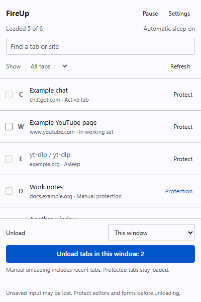

# FireUp

If you keep a lot of Firefox tabs open but only use a few of them, FireUp can unload the ones sitting in the background. They stay in the tab bar and reload when you return to them.

[Install from Firefox Add-ons](https://addons.mozilla.org/firefox/addon/fireup-optimize/) · [Report a bug](https://github.com/tyvor/fireup-optimize/issues)

FireUp is for desktop Firefox 140 or newer. The source on GitHub may be ahead of the version available on Mozilla.



The screenshot uses demonstration tabs.

## How it works

By default, your 10 most recently used tabs stay loaded. Other tabs can sleep after 10 minutes of inactivity. You can change both values in settings. Protection can keep more than 10 tabs loaded.

Active tabs in each window, pinned tabs and tabs playing audio stay loaded. FireUp also skips calls and screen sharing when Firefox reports them. Private tabs and internal pages such as `about:settings` are excluded.

Use **Protect** for tabs you want to keep loaded. Protection can last 30 minutes, an hour, or until you remove it. You can also exclude a site in settings; a domain rule covers its subdomains too. There's a grace period on first installation so you can set this up before automatic unloading starts.

Protect editors, forms with unsaved text and silent playback yourself. FireUp doesn't read page contents, so it can't reliably recognize all of these. Unloading a page can lose unsaved work.

## Using the panel

The panel lets you search and filter the list, protect tabs and unload them manually. Choose the current window, all windows, checked tabs or a site. The button shows which scope you're using and how many tabs are eligible. **Stop** cancels the rest of a running queue.

Search and filters only change what you see in the list. Hidden tabs in the chosen scope are still included in an unload command. Choose **Selected tabs** to act only on checked rows.

A manual command can unload recent tabs and skips automatic waiting periods. It still respects protection and site exclusions. **Alt+Shift+U** runs that command across all windows. Pausing automatic sleep leaves manual commands available.

If you return to a tab within two minutes of FireUp unloading it, its next automatic sleep is delayed. Repeated quick returns increase that delay, up to two hours. You can turn this off in settings.

## Settings and language

Choose a light, dark or system theme. The interface starts in Russian if Firefox uses Russian, and English otherwise. **Settings → Language** lets you override that choice. Save the setting to keep it for the panel, settings page and tab context menu.

You can export settings to a local JSON file and review an import before applying it. The file includes preferences, language and excluded domains. It doesn't include open tabs or per-tab protection. Exports from 0.3.0 still import; they reset the language to **Browser default**. Newer exports use format 2, which 0.3.0 can't read.

## Privacy

FireUp uses tab titles, URLs and browser-reported states to show the list and decide what can sleep. That information stays in your Firefox profile. The extension has no analytics, advertising, remote code or server component.

Settings survive browser restarts. Temporary activity records and queued tab URLs last for the current browser session. Firefox may restore a tab's protection when it restores that tab. The [privacy notice](PRIVACY.md) explains what is stored, and [Permissions](docs/PERMISSIONS.md) explains each permission.

## Development

To try the source, open `about:debugging#/runtime/this-firefox`, choose **Load Temporary Add-on** and select `extension/manifest.json`. Firefox removes temporary add-ons when it restarts.

The extension runs directly from `extension/`; there's no JavaScript build step. The logic tests need Node.js 22 or newer:

```sh
npm test
```

For the rest of the checks:

```sh
npm ci
npx playwright install chromium
npm run check:source
npm run test:ui
npm run lint:addon
```

The UI tests use Chromium with modeled Firefox APIs. They help catch interface regressions but don't replace testing in Firefox. See [Testing](docs/TESTING.md), [Build instructions](BUILD-INSTRUCTIONS.md) and [Release status](docs/RELEASE-STATUS.md).

## Bugs and contributions

[Open an issue](https://github.com/tyvor/fireup-optimize/issues) with your FireUp, Firefox and OS versions and the steps that reproduce the problem. English and Russian reports are welcome. Please redact private tab titles, URLs and domains before attaching files or screenshots. [Contributing](CONTRIBUTING.md) has details for code changes.

Memory savings depend on the pages and Firefox. FireUp uses Firefox's tab-unloading API; it doesn't close tabs or kill processes. Firefox can decline an unload request, and the sleep times shown in the panel are approximate.

FireUp is open source under the [MIT license](LICENSE).
